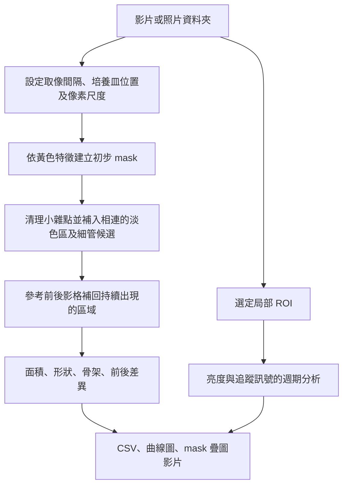

# 黏菌影像分析程式：整體架構與實際能力查核

查核日期：2026-11-13。範圍為本機 `SpaceCellCam/plasmodium`，重點是 V2 主流程、AI pilot、兩份 publication 驗證工具。舊單檔版本做入口與版本盤點，沒有逐行重審所有歷史版本。本次沒有修改分析程式、既有標註或原始影片。

## 1. 整體判斷

目前是一套已具備操作介面、分批分析、影像分割、量測與輸出的研究用軟體。正式分析核心仍是**傳統影像處理**；SAM2 位於獨立的標註實驗支線，沒有接入正式分析，也未找到專用模型訓練完成的證據。

程式能把影片中的黏菌外觀變成 mask，再計算面積、形狀、前後變化、骨架與亮度訊號。但「程式能產出數字」、「mask 是否準確」、「數字是否反映真正生物變化」是三個不同問題。目前第一項有軟體測試支持，後兩項仍需要真實影像的人工標註、配準驗證與實驗校正。

最需要優先處理的是：**量測仍受到整體震動影響、發表用驗證入口與正式補償流程不一致、草稿與人工確認標註的界線不夠嚴格。**

## 2. 專案其實包含哪些部分

| 部分 | 入口或位置 | 實際角色 |
|---|---|---|
| 原始及歷史版本 | 根目錄多支 `plasmodium_brightfield_analysis_*.py` | 保留不同時期的單檔程式與試驗版本；不能只靠檔名認定輸出來源 |
| optimized 版本 | `plasmodium_brightfield_analysis_optimized.py` | 根目錄 `OFFICIAL_ANALYSIS_WORKFLOW.md` 指定的入口，也是根目錄 publication config 的演算法來源 |
| V2 分析系統 | `plasmodium_analysis_v2/run_ui.py` 或 `run_spyder.py` | 有設定管理、桌面介面、背景執行、獨立輸出目錄與拆出的分割模組 |
| AI pilot | `ai_segmentation_pilot/` | 抽取代表影像、配準、產生 V2 弱標註與 SAM2 草稿、提供人工編修 |
| 發表用驗證工具 | 根目錄及 V2 各一份 `publication_validation_system/` | 抽樣、盲標註、演算法凍結、預測與評估；兩份使用不同演算法入口 |

文件尚未統一：根 README 說明原始版本、根工作流程指向 optimized、V2 README 則建議 V2 UI。這些文件可以各自描述其版本，但使用者容易以為所有結果來自同一套程式。

本次讀到的父專案 Git HEAD 為 `198a8e3`，但 optimized、V2 與 AI pilot 等重要內容仍為未追蹤檔案；根 publication config 有既有未提交修改。因此此 commit **不能單獨代表目前分析程式版本**。本次另外保存 78 個來源檔的 SHA-256 清單，供之後比對；清單不代表每個檔案都已逐行審查。

## 3. V2 的實際流程

從程式呼叫看，UI 透過獨立的背景程序啟動 `runner.run_analysis()`；runner 檢查設定、決定工作程序數及批次大小、建立輸出目錄，再呼叫 `engine.run()`。UI 實作使用 Python multiprocessing，並非文件中可能誤寫的 Qt QProcess。

| 模組 | 負責的工作 |
|---|---|
| `config.py`、`user_config.py` | 輸入、模式、尺度、時間、效能設定 |
| `ui_app.py`、`ui_worker.py` | 操作介面、背景執行、日誌、停止與子程序清理 |
| `runner.py`、`run_context.py` | 啟動分析、隔離輸出、記錄 running/completed/failed 等狀態 |
| `performance.py` | CPU 與記憶體相關的批次規劃 |
| `segmentation.py`、`mask_utils.py` | 單張影像的 mask |
| `temporal.py` | 前後影格投票、局部平移補償 |
| `engine.py` | 影片讀取、批次流程、量測、ROI、圖表及多種模式；仍有 9,333 行 |
| `manual_validation.py` | 抽取影像與對應自動 mask，提供人工比對工作包 |
| `validation_api.py` | 對外暴露分割與時間處理函式，供 publication 工具使用 |

呼叫鏈依據：[runner.py:21](C:/Users/chen8/Documents/PlatformIO/Projects/SpaceCellCam/plasmodium/plasmodium_analysis_v2/plasmodium_v2/runner.py:21)、[ui_app.py:235](C:/Users/chen8/Documents/PlatformIO/Projects/SpaceCellCam/plasmodium/plasmodium_analysis_v2/plasmodium_v2/ui_app.py:235)、[engine.py:8003](C:/Users/chen8/Documents/PlatformIO/Projects/SpaceCellCam/plasmodium/plasmodium_analysis_v2/plasmodium_v2/engine.py:8003)。本次也使用本機 Graphify 的呼叫關係輔助定位，再以來源確認；沒有同步 Hindsight 或開啟圖譜網頁。

### 執行模式需要區分

- `validation_all/front/middle/rear`：分析前中後抽樣片段，讓人檢查輸出；名稱中的 validation 不代表已通過人工準確度驗證。
- `formal_only`：執行所選資料的正式分析流程；formal 是執行範圍，不是科學有效性的認證。
- `formal_with_validation`、`complete`：組合正式分析及其他輸出階段。
- `contraction_roi`：局部 ROI 的亮度／追蹤分析。
- `manual_validation_export/annotate/score`：產生、編修及比對人工標註；annotate/score 必須指定先前輸出目錄。

現行 `user_config.py` 預設為 `validation_all`，所以直接執行它不等於已完成全片正式分析；UI 另外會載入保存過的設定，實際某次執行應以該次 manifest 為準。

## 4. mask 怎麼產生，為什麼換影像仍會不穩

可把 mask 想成「電腦在照片上塗出的黏菌範圍」。目前先找黃色且符合亮度條件的像素，再利用相連性與附近細長結構補回漏掉的區域。

V2 `engine.run()` 的設定為 HSV H=15–49、S≥54、V≥30；另啟用黃色色差延伸，以及最多補入原本體面積 2% 的細管特徵。時間補回使用五張中至少四張出現的候選區域。正式計算保留原解析度，疊圖影片才縮至一半。這些是主入口內的設定，不應直接拿模組函式的預設值代替。

來源：[engine.py:8254](C:/Users/chen8/Documents/PlatformIO/Projects/SpaceCellCam/plasmodium/plasmodium_analysis_v2/plasmodium_v2/engine.py:8254)、[engine.py:8408](C:/Users/chen8/Documents/PlatformIO/Projects/SpaceCellCam/plasmodium/plasmodium_analysis_v2/plasmodium_v2/engine.py:8408)。

這套方法仍有明確限制：

1. **固定顏色條件**：曝光、白平衡、黏菌顏色與背景改變，會改變哪些像素能通過門檻。
2. **保留最大連通區**：能去掉雜點，也可能丟掉被漏抓細枝隔開的真實黏菌。
3. **時間補回以加回為主**：保留當前空間 mask，不能用時間投票自動刪除所有已錯抓的背景。
4. **補抓範圍受限制**：細管補抓上限、皿緣排除與洞內不補等規則能控制誤抓，也會限制召回量。

這些解釋了為何目前的 V2 不是「只要調一組參數就能適用所有時期與影片」的系統。限制來自演算法設計；是否能接受，仍要用分期、分影片的人工真值量化。

來源：[segmentation.py:159](C:/Users/chen8/Documents/PlatformIO/Projects/SpaceCellCam/plasmodium/plasmodium_analysis_v2/plasmodium_v2/segmentation.py:159)、[temporal.py:217](C:/Users/chen8/Documents/PlatformIO/Projects/SpaceCellCam/plasmodium/plasmodium_analysis_v2/plasmodium_v2/temporal.py:217)。

## 5. 震動補償目前做到哪裡

V2 會利用培養皿邊緣估計平移，暫時把一批影格的 mask 對齊，方便投票補回淡色部分。完成後，mask 又轉回各自影格的原始座標。它目前不估旋轉，也沒有把後續所有量測統一放在穩定的培養皿座標下。

因此，「mask 補回時有參考位移」和「新增／退縮量測已排除震動」不能畫上等號。

**本次合成例子：**20×20 像素的方形保持形狀與面積不變，只向右平移 3 像素。呼叫現行差異量測函式後，得到新增 60 px²、退縮 60 px²、淨面積變化 0；取像間隔設為 10 秒時，前緣速度第 95 百分位為 0.3 px/s。這是數學上的座標差異，不是真實生長，也不是實際影片測得的誤差幅度。

來源：[temporal.py:189](C:/Users/chen8/Documents/PlatformIO/Projects/SpaceCellCam/plasmodium/plasmodium_analysis_v2/plasmodium_v2/temporal.py:189)、[temporal.py:251](C:/Users/chen8/Documents/PlatformIO/Projects/SpaceCellCam/plasmodium/plasmodium_analysis_v2/plasmodium_v2/temporal.py:251)、[engine.py:887](C:/Users/chen8/Documents/PlatformIO/Projects/SpaceCellCam/plasmodium/plasmodium_analysis_v2/plasmodium_v2/engine.py:887)、[engine.py:3196](C:/Users/chen8/Documents/PlatformIO/Projects/SpaceCellCam/plasmodium/plasmodium_analysis_v2/plasmodium_v2/engine.py:3196)。

另有待測試風險：配準不可信時回退原座標，其他成功影格仍在對齊座標下投票；批次中央影格作為基準，也可能使批次大小影響補償。這次未量測不同批次實際造成多少差異，不能把它寫成已觀察的實驗結果。

## 6. AI、V2 弱標註與 SAM2 的真正關係

AI pilot 的流程是：**8 支影片 → 每支抽取 15 張 → 傳統影像配準 → 分別產生 V2 弱標註或 SAM2 草稿 → 人工編修**。目前未連至正式分析。

| 項目 | 本次本機盤點 |
|---|---:|
| 來源影片 | 8 支：轉 4、不轉 4 |
| 抽取並配準影像 | 120 張 |
| train / val / test | 60 / 30 / 30 張；影片數為 4 / 2 / 2 |
| V2 弱標註 | 120 張 |
| SAM2 草稿 | 19 張 |
| `masks_verified` 內檔案 | 0 張 |

此處 0 張只指 AI pilot 的指定資料夾，不代表整台電腦沒有其他人工標註。

**V2 弱標註**是 `generate_v2_weak_labels.py` 呼叫 V2 的 `segment_hsv_circle()`，使用腳本內的固定參數逐張計算。它屬於傳統影像處理產生的草稿；不含時間補回，也不代表模型訓練。

**SAM2 草稿**使用已提供的 checkpoint 做單張影像推論。程式先另外計算 HSV 種子，產生提示點、框與可選的 mask 提示，再進行 SAM2 預測、候選選擇、皿內裁切與連通性處理。預設 `weak_mask` 不會直接讀入 V2 弱標註資料夾，因此不能把兩種草稿混稱為同一流程。

現行程式未保存每次 SAM2 執行的完整提示、模式、來源版本與權重雜湊，因此不能反推現存 19 張全部用了哪種提示。可以確認目前程式使用 `torch.inference_mode()` 與 `SAM2ImagePredictor`，未看到訓練迴圈；也沒有使用 SAM2 的影片記憶傳播。checkpoint 檔名為 `sam2.1_hiera_small.pt`，本次未比對官方權重 hash。

Pilot 的配準是 ECC 平移加小角度旋轉，與 V2 的時間投票平移補償不同。manifest 記錄 119 張使用 ECC、1 張使用平移回退；這只是程式紀錄，並不是配準精度的人工驗證。

來源：[generate_v2_weak_labels.py:37](C:/Users/chen8/Documents/PlatformIO/Projects/SpaceCellCam/plasmodium/ai_segmentation_pilot/generate_v2_weak_labels.py:37)、[generate_sam2_drafts.py:108](C:/Users/chen8/Documents/PlatformIO/Projects/SpaceCellCam/plasmodium/ai_segmentation_pilot/generate_sam2_drafts.py:108)、[registration.py:45](C:/Users/chen8/Documents/PlatformIO/Projects/SpaceCellCam/plasmodium/ai_segmentation_pilot/plasmodium_ai/registration.py:45)。

## 7. 指標可以怎麼解讀

| 程式輸出 | 可以描述 | 目前不能直接等同 |
|---|---|---|
| mask 面積 | 二維可見覆蓋範圍 | 生物量、體積、健康程度 |
| 圓度、緊實度、偏心率 | 外觀與形狀差異 | 處理組的因果效應 |
| 新增、退縮、前緣速度 | 相鄰 mask 的影像差異 | 已排除震動的真實移動／生長 |
| 骨架長度與分叉點 | 一像素中心線的影像特徵 | 精確管路長度與真實分叉數 |
| ROI 亮度週期、追蹤週期 | 影像訊號中可能的週期變化 | 已證實的生理收縮、細胞質流量或力 |
| QC 或 confidence 等級 | 程式規則下的可疑程度 | 已對照真值校正的準確率或機率 |

骨架長度目前以骨架像素數計算，沒有斜向連線的 √2 加權；分叉點直接數鄰居≥3 的像素，同一交會處可能重複計數。來源：[engine.py:577](C:/Users/chen8/Documents/PlatformIO/Projects/SpaceCellCam/plasmodium/plasmodium_analysis_v2/plasmodium_v2/engine.py:577)。

時間軸使用設定的原始拍攝間隔，不是影片播放 FPS，這個設計合理。但 `frame_interval_sec=10` 必須符合真實拍攝紀錄；`pixel_size=1` 本身不是實體尺度校正，未校正時應使用 px、px²、px/s。來源：[engine.py:8169](C:/Users/chen8/Documents/PlatformIO/Projects/SpaceCellCam/plasmodium/plasmodium_analysis_v2/plasmodium_v2/engine.py:8169)。

## 8. 確定問題與修正優先順序

### 優先一：會影響結果可信度

**A. 量測沒有完整排除整體移動。**

前述 3 像素平移例子已重現。應先定義哪些量測在培養皿固定座標下進行，保留原影像與每格變換，並區分相機／皿移動與生物本身變形。不能直接以黏菌自身的變形做消震，否則可能消掉要量的訊號。

**B. V2 publication 驗證漏接運動補償必要資料。**

`generate_predictions.py` 建立的 temporal item 沒有 `dish_center`、`dish_radius` 或 `pre_debug`。`temporal.py` 找不到這些資料就整批回傳不補償。正式 engine 有帶資料，所以驗證入口與正式入口不一致。本次用缺 geometry 的五個 item 確認：五個都回傳 identity，沒有任何 accepted transform。

來源：[generate_predictions.py:169](C:/Users/chen8/Documents/PlatformIO/Projects/SpaceCellCam/plasmodium/plasmodium_analysis_v2/publication_validation_system/generate_predictions.py:169)、[temporal.py:63](C:/Users/chen8/Documents/PlatformIO/Projects/SpaceCellCam/plasmodium/plasmodium_analysis_v2/plasmodium_v2/temporal.py:63)。應使用共同的影格準備函式與參數快照，再以同一合成位移影片比對兩個入口的 mask。

**C. AI 草稿翻頁時會自動存入 verified。**

`review_masks.py` 的 n/p 翻頁都會呼叫 save，即使使用者只是瀏覽、沒有修改或明確確認，草稿也會進入 `masks_verified`。驗證器主要檢查檔案存在與格式，無法證明人工審查。目前該資料夾為 0 張，沒有發現已發生的標註污染。

來源：[review_masks.py:55](C:/Users/chen8/Documents/PlatformIO/Projects/SpaceCellCam/plasmodium/ai_segmentation_pilot/review_masks.py:55)、[review_masks.py:82](C:/Users/chen8/Documents/PlatformIO/Projects/SpaceCellCam/plasmodium/ai_segmentation_pilot/review_masks.py:82)。應分開「保存草稿」與「確認完成」，記錄確認者、時間、影像與標註版本。

**D. 發表驗證的演算法鎖沒有一起鎖住驗收規則。**

參數 hash 只含 implementation、body_hsv_params、temporal_params；不含 acceptance、primary_method 等評估方案。評估讀取當下 config 並引用預測紀錄的 eligible 旗標。純記憶體檢查確認：改 Dice 門檻與主方法後，演算法參數 hash 不變。這是防止無意中事後改規則的缺口，沒有證據顯示既有結果曾因此被操縱。

來源：[common.py:55](C:/Users/chen8/Documents/PlatformIO/Projects/SpaceCellCam/plasmodium/plasmodium_analysis_v2/publication_validation_system/common.py:55)、[evaluate_validation.py:617](C:/Users/chen8/Documents/PlatformIO/Projects/SpaceCellCam/plasmodium/plasmodium_analysis_v2/publication_validation_system/evaluate_validation.py:617)。應把資料清單、評估方案與門檻一起保存成不可混用的快照，評估時重新核對。

### 優先二：改善品質判斷與重現能力

| 問題 | 確定行為或觸發條件 | 建議 |
|---|---|---|
| 空真值的誤差定義 | 真值全空、預測有16像素時，Dice=0，但相對面積誤差欄 `absolute_area_error`=0；單邊空的 HD95 為 NaN，摘要會排除非有限值 | 空樣本分開計數，明確定義 false-positive 與不可計算值；不能解讀成零誤差 |
| tracker 失敗仍算有效 | 低配對分數只凍結框，數值仍有限；有效比例使用 isfinite，間歇失敗可能仍顯示100%有效 | 逐格標記失敗，週期分析排除或明確處理失敗區間 |
| best_signal 不具可比尺度 | 位移、光流與灰階差以不同單位的原始振幅競爭，且未先排除 invalid | 使用各訊號自己的品質條件；不要直接稱為最可信收縮結果 |
| 記憶體預算非硬上限 | 1 GiB可用RAM、16 CPU的模擬下，預算0.55 GiB仍安排15 workers/15 frames，按程式自己的估算需1.32 GiB | 工作程序數與批次同時受記憶體限制；影像尺寸也應納入 |
| 一般執行記錄不完整 | run manifest 只記 engine.py hash；改 segmentation.py 或 temporal.py 仍可能得到相同 engine hash | 保存整套有效模組、全部演算法參數、來源資料識別與套件版本 |
| 標註與影像可能脫鉤 | AI prepare 可覆寫同 sample_id 的配準影像；改配準後重跑，舊 mask 不會自動失效 | 以影像hash與配準版本綁定標註，保留版本並重審 |
| Pilot 配準開關無效 | `registration.enabled` 被移除後仍一律呼叫配準，設false也無法建立真正不補償對照 | 讓開關控制執行路徑並加入對照測試；現行true不因此判錯 |

對應來源：[validation_metrics.py:176](C:/Users/chen8/Documents/PlatformIO/Projects/SpaceCellCam/plasmodium/plasmodium_analysis_v2/publication_validation_system/validation_metrics.py:176)、[engine.py:6975](C:/Users/chen8/Documents/PlatformIO/Projects/SpaceCellCam/plasmodium/plasmodium_analysis_v2/plasmodium_v2/engine.py:6975)、[engine.py:7056](C:/Users/chen8/Documents/PlatformIO/Projects/SpaceCellCam/plasmodium/plasmodium_analysis_v2/plasmodium_v2/engine.py:7056)、[engine.py:7101](C:/Users/chen8/Documents/PlatformIO/Projects/SpaceCellCam/plasmodium/plasmodium_analysis_v2/plasmodium_v2/engine.py:7101)、[performance.py:20](C:/Users/chen8/Documents/PlatformIO/Projects/SpaceCellCam/plasmodium/plasmodium_analysis_v2/plasmodium_v2/performance.py:20)、[run_context.py:51](C:/Users/chen8/Documents/PlatformIO/Projects/SpaceCellCam/plasmodium/plasmodium_analysis_v2/plasmodium_v2/run_context.py:51)、[dataset.py:76](C:/Users/chen8/Documents/PlatformIO/Projects/SpaceCellCam/plasmodium/ai_segmentation_pilot/plasmodium_ai/dataset.py:76)。

Publication 工具還需要把標註原圖、影片、manifest 與 prediction 的身分連在一起：目前雖保存抽樣圖片 hash，後續預測重新讀原影片，評估未完整核對該身分鏈。原影片被替換或預測檔混用是條件性風險，本次沒有發現實際混檔事件。

### 優先三：維護與使用體驗

V2 已拆出重要模組，但 engine.py 仍超過九千行，多個執行模式與輸出功能集中在一起。應先統一正式入口、參數來源與驗證呼叫，再逐步分離讀片、指標、ROI及輸出；不必立即大規模重寫。

歷史版本應保留並建立版本索引。分析設定、輸出名稱與每次報告需能對應到一個可重現版本；目前大量核心程式尚未納入 Git，是追溯上的實際缺口。

## 9. 本次做過哪些檢查

| 檢查 | 結果 | 證據範圍 |
|---|---|---|
| V2 既有 pytest | 11 passed，8.43秒 | strict像素保留、halo、合成平移補枝、補抓上限、手動工作包、延續工作、離屏UI及串流ROI等 |
| AI pilot 既有 pytest | 2 passed，0.50秒 | 整支影片拆分規則、合成影像配準；未跑GPU或SAM2推論 |
| V2 合成影片流程 | 通過 | 14張合成影格中分析5張；輸出82欄CSV，manifest=completed，64×64疊圖影片可解碼 |
| V2 publication 合成流程 | 通過 | 30張樣本能走完準備、凍結、預測與評估；overall status仍為NOT_ESTABLISHED |
| 純平移量測探測 | 已重現假新增／退縮 | 20×20方形位移3像素，新增與退縮各60 px² |
| 缺geometry探測 | 已重現補償停用 | 五個item回identity，accepted transforms=0 |
| 低記憶體規劃探測 | 已重現超出自身預算估算 | 0.55 GiB預算與約1.32 GiB批次估算 |
| 驗收鎖與空真值探測 | 已重現上述邊界 | 純記憶體檢查，沒有改原設定或標註 |

環境：Python 3.12.12、OpenCV 4.12.0、NumPy 2.3.5、SciPy 1.16.3、scikit-image 0.25.2、pytest 8.4.2、PyQt 5.15.11。

Publication 合成測試把程式自己的 temporal 預測複製成「參考標註」，因此高 Dice 是預期的自我一致性檢查，**不是人工標註準確率**。程式保留 NOT_ESTABLISHED 的行為正確。

本次未跑全長真實影片、未重新訓練模型、未做實驗組差異統計，也未進行現場相機、尺度或真實振動量測。UI只有離屏建構測試，未做人工點擊完整流程。根目錄歷史引擎與其publication smoke未重新執行，不能套用V2測試結果。

原始兩份 publication config 均為 development_not_frozen；本次檢查前，兩個預設 publication 輸出根都不存在。這表示在這兩個指定位置沒有找到正式驗證包，不能推論整台電腦沒有其他資料。本次新產生的合成工作包位於獨立查核目錄，不能計入研究進度。

## 10. 下一步建議與驗收條件

1. **統一執行與驗證路徑。** 同一影像、參數與上下文，正式流程與驗證工具應產生相同 mask；補償是否使用、失敗原因都需明確輸出。
2. **讓量測使用正確的共同座標。** 用已知平移／旋轉的合成影片驗證；無生物變化時，補償後新增／退縮應接近0，再用真實皿緣位置驗證配準誤差。
3. **建立可追溯的人工標註。** 草稿不自動升格真值；按影片／獨立培養分組，保留來源與確認紀錄，再量化各期、轉與不轉的錯誤。
4. **修正評估與品質門檻。** 凍結驗收方案，處理空mask與追蹤失敗，再做獨立測試集評估。
5. **根據錯誤分布決定是否訓練AI。** 先區分主要問題是顏色差異、細網、背景還是震動；人工標註與資料版本穩定後，再比較傳統方法、提示式SAM2及後續專用模型。

可對老師描述的現況是：**已完成傳統影像分析與AI標註試驗工具，軟體基本流程可運作；目前正在處理跨影片分割差異與移動造成的量測誤差，尚未完成專用AI模型訓練與獨立人工準確度驗證。**

查核紀錄：[任務與測試資料夾](C:/Users/chen8/Documents/PlatformIO/Projects/SpaceCellCam/plasmodium/.planning/20261113-program-analysis/)。來源快照：[source_snapshot.json](C:/Users/chen8/Documents/PlatformIO/Projects/SpaceCellCam/plasmodium/.planning/20261113-program-analysis/source_snapshot.json)。
